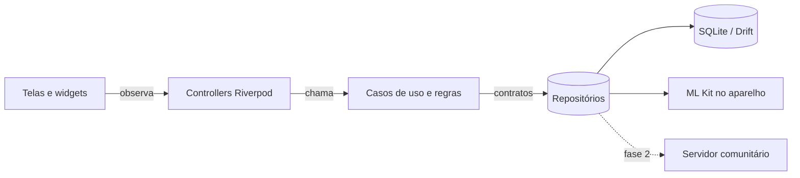

# Arquitetura

Este documento descreve como o código do Bipa é organizado e as regras que mantêm essa organização. As decisões e seus motivos estão registradas em [`adr/`](adr/README.md).

## Visão geral

O Bipa é um app Flutter **offline-first**: o banco SQLite no aparelho é a fonte da verdade, e tudo funciona sem internet. A sincronização com a base comunitária (fase 2) será uma camada a mais, que não muda o funcionamento local.



## Estrutura de pastas

Organização **por funcionalidade** (feature-first). Cada funcionalidade tem as mesmas camadas:

```
lib/
├── main.dart                  # ponto de entrada: ProviderScope + BipaApp
├── app/                       # MaterialApp, rotas (go_router), tema
├── core/                      # código compartilhado, sem regra de negócio de uma feature
│   ├── backup/                # onde ficam o banco, as fotos e o ultimo.bipa; a troca segura dos arquivos
│   ├── database/              # Drift: tabelas, AppDatabase, migrações
│   ├── design_system/         # tokens e componentes visuais do Bipa
│   ├── l10n/                  # textos (ARB) e código gerado de localização
│   ├── money/, location/, ... # value objects e utilitários puros
│   └── di/                    # providers globais (relógio, gerador de IDs)
└── features/
    └── <feature>/             # products, markets, prices, stock, shopping_list, backup...
        ├── domain/            # entidades, contratos, casos de uso, regras puras
        ├── data/              # implementações: Drift, ML Kit, API
        └── presentation/
            ├── providers.dart # injeção de dependências da feature
            └── <tela>/        # <tela>_screen.dart, <tela>_controller.dart, widgets/
```

Os testes espelham `lib/`: `test/features/prices/domain/...` testa `lib/features/prices/domain/...`.

## Regra de dependência

As setas só apontam para dentro, em direção ao domínio:

| Camada | Pode importar | Não pode importar |
| --- | --- | --- |
| `domain` | Dart puro, `meta`, `freezed_annotation`, `core` puro (money, location) | Flutter, Drift, Riverpod, ML Kit, outras features* |
| `data` | `domain` da própria feature, `core`, Drift, ML Kit, http | `presentation` |
| `presentation` | tudo acima, Flutter, Riverpod, `core/design_system` | detalhes de `data` fora do `providers.dart` |

\* Uma feature pode usar entidades do domínio de outra (o caso de uso de preços resolve um `Product`), nunca suas telas ou implementações.

Consequência prática: o domínio inteiro roda em testes de unidade puros, com repositórios falsos e sem emulador.

## Estado e injeção de dependências

Usamos **Riverpod com geração de código** (`riverpod_generator`) e **freezed** para classes imutáveis.

- **Dependências** (repositórios, serviços) são providers `@Riverpod(keepAlive: true)` declarados em `presentation/providers.dart`, que ligam o contrato do domínio à implementação de `data`. Testes trocam a implementação com `overrides`.
- **Estado de tela** fica em um controller `@riverpod class XController extends _$XController`, um `AsyncNotifier` quando há carregamento. A tela só observa (`ref.watch`) e chama métodos do controller; ela não fala com repositórios.
- **Ações** que podem falhar usam `AsyncValue.guard`. Eventos únicos (mensagem, navegação) são tratados na tela com `ref.listen`.
- **Entidades e estados** são classes `freezed`: imutáveis, com `==`, `copyWith` e uniões seladas para estados distintos.

```dart
@riverpod
class StockController extends _$StockController {
  @override
  Stream<List<StockEntry>> build() => ref.watch(stockRepositoryProvider).watchAll();

  Future<void> consume(String productId) => ref
      .read(stockRepositoryProvider)
      .adjust(productId: productId, delta: -1, reason: StockMovementReason.consumption);
}
```

## Dados e offline-first

- **Drift** gera consultas tipadas e streams reativas: a tela atualiza sozinha quando o banco muda.
- **IDs UUID** são gerados no aparelho, para registros criados offline nunca colidirem no servidor.
- **Preços são eventos imutáveis** (só inserção). Na sincronização não existe conflito de edição.
- **Outbox:** tabelas compartilháveis (`products`, `markets`, `price_observations`) têm `synced_at`. Nulo significa pendente de envio. O estoque e a lista de compras são privados e nunca saem do aparelho.
- **Migrações:** toda mudança de esquema sobe o `schemaVersion` e ganha um passo em `MigrationStrategy.onUpgrade`, com teste de migração. Do esquema 14 em diante, o esquema de cada versão fica em `drift_schemas/` (`drift_dev schema dump`), e o teste parte dele (ADR 0023; passo a passo em [contribuindo.md](contribuindo.md#mudança-no-esquema-do-banco)).
- **Backup:** o `.bipa` é um zip com o próprio banco, as fotos e um manifesto (ADR 0023, seção 5), em `features/backup`. Restaurar troca o arquivo do banco: o serviço fecha o banco, troca os arquivos e descarta o `appDatabaseProvider`, e tudo o que o observa recarrega. Por isso, nada guarda o `AppDatabase` fora de um provider que o observe com `ref.watch`.

## Valores e unidades

- Dinheiro é sempre `Money`, em centavos (`int`). `double` nunca representa preço.
- Quantidades de embalagem usam `MeasureUnit`, e a comparação entre embalagens usa o preço por unidade base (R$/kg, R$/L, R$/un).

## Erros

- Regras de negócio violadas lançam subclasses de `DomainException`, com mensagem pronta para o usuário.
- Erros inesperados (banco, câmera, ML Kit) são capturados no controller, viram uma mensagem genérica na tela e são registrados no log. Falhas não tratadas vão para o Sentry só se a pessoa aceitar, e passam antes por um filtro que tira todo dado dela ([ADR 0025](adr/0025-relatorio-de-falhas-com-sentry-e-consentimento.md)).

## Interface

- Toda cor, espaçamento, raio e estilo de texto vem do design system (`core/design_system`), espelho do [Bipa Design System](design/identidade-visual.md). Valores literais em widgets de feature não passam na revisão.
- Textos visíveis ficam em arquivos ARB (`core/l10n/app_pt.arb`), mesmo com um idioma só: facilita revisão de texto e uma tradução futura.
- Navegação com `go_router`. Rotas nomeadas em `core/navigation/routes.dart`.

## Testes

| Nível | O que cobre | Ferramenta |
| --- | --- | --- |
| Unidade | domínio: regras, casos de uso, parser de etiquetas | `flutter_test` + fakes |
| Repositório | consultas e transações Drift | banco em memória (`NativeDatabase.memory`) |
| Widget | telas com providers sobrescritos | `flutter_test` + `ProviderScope(overrides:)` |
| Integração | fluxo de bipar ponta a ponta | `integration_test` (fase 1) |

Todo bug corrigido ganha um teste que o reproduz.
