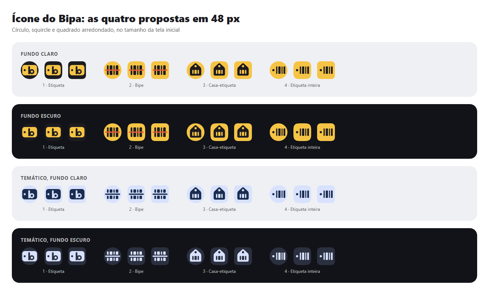

# Ícone do app: propostas

Quatro direções para o mantenedor escolher vendo. Nenhuma está no app ainda: a escolhida entra depois em `android/`, e a aprovação vem antes.



| Proposta | Prancha | Camadas |
| --- | --- | --- |
| 1 · Etiqueta | [prancha](1-etiqueta/prancha.png) | [fundo](1-etiqueta/fundo.svg), [primeiro plano](1-etiqueta/frente.svg), [monocromático](1-etiqueta/mono.svg) |
| 2 · Bipe | [prancha](2-bipe/prancha.png) | [fundo](2-bipe/fundo.svg), [primeiro plano](2-bipe/frente.svg), [monocromático](2-bipe/mono.svg) |
| 3 · Casa-etiqueta | [prancha](3-casa/prancha.png) | [fundo](3-casa/fundo.svg), [primeiro plano](3-casa/frente.svg), [monocromático](3-casa/mono.svg) |
| 4 · Etiqueta inteira | [prancha](4-etiqueta-inteira/prancha.png) | [fundo](4-etiqueta-inteira/fundo.svg), [primeiro plano](4-etiqueta-inteira/frente.svg), [monocromático](4-etiqueta-inteira/mono.svg) |

Cada prancha mostra as camadas na grade de 108 dp (com a área visível e a zona segura), o ícone nas máscaras círculo, squircle e quadrado arredondado em 192 e 48 px sobre fundo claro e escuro, e o monocromático temático.

## Referências

**Android** ([ícones adaptativos](https://developer.android.com/develop/ui/views/launch/icon_design_adaptive)): fundo e primeiro plano separados, de 108 × 108 dp; os 18 dp de cada borda são da máscara do fabricante, e só os 66 dp do centro nunca são cortados. O desenho tem de 48 a 66 dp, sem sombra nem máscara própria. Do Android 13 em diante, uma camada monocromática deixa o sistema pintar o ícone com as cores do papel de parede; no Android 16 QPR 2, quem não tem essa camada é pintado automaticamente.

**Apps vizinhos** (levantamento de memória: a Play Store estava bloqueada para o agente, vale conferir antes de decidir):

- O amarelo está cheio na tela inicial brasileira: Mercado Livre (aperto de mãos), Banco do Brasil (BB azul), Google Keep (lâmpada branca), Snapchat (fantasma branco). Todos põem branco ou azul sobre o amarelo.
- Leitores de código genéricos usam código de barras com uma linha vermelha ou os cantos de um visor.
- Listas de compras usam um objeto simples sobre fundo chapado (o Bring!, por exemplo, uma sacola com visto).

**O que levamos:** uma silhueta só, sólida, sobre fundo chapado, que é o que sobrevive a 48 px e ao monocromático; o desenho dentro dos 66 dp; uma camada monocromática nossa, para não depender da pintura automática.

**O que fazemos diferente:** ink (quase preto) sobre o amarelo, como na etiqueta de gôndola, o que nos separa dos vizinhos amarelos; o furo da etiqueta (o da `PriceTag`) como assinatura no lugar do laser vermelho dos leitores genéricos; nenhum texto nem "R$" no ícone; um acento só, sem o coral, que no app é reservado ao alerta.

## Comparação

| | Legível em 48 px | Ligação com a marca | Risco de parecer outro app |
| --- | --- | --- | --- |
| **1 · Etiqueta** | Ótima: a etiqueta e o "b" leem de longe | Forte com a `PriceTag`, mas o ícone fica escuro (o amarelo vira só a etiqueta) e cria um monograma que o símbolo não tem: o logo teria de mudar | Baixo. No papel de parede escuro, o fundo ink some e sobra só a etiqueta |
| **2 · Bipe** | Boa em cor. No monocromático, os respiros entre as barras e o laser têm 3,4 dp (cerca de 1,5 px) e quase fecham | Máxima: é o símbolo atual, que o README dos logos já indica como ícone | Alto: código de barras com linha vermelha é o ícone de leitor genérico. O coral no ícone também gasta a cor de alerta |
| **3 · Casa-etiqueta** | Ótima: uma silhueta sólida, a melhor no monocromático | Média: amarelo e ink, estoque e preço numa forma só, mas sem relação com o símbolo | Médio: casa com etiqueta de preço lembra "imóvel à venda" (apps de imóveis), e casas são comuns (casa inteligente) |
| **4 · Etiqueta inteira** | Boa: o furo e quatro barras, sem cor extra. O furo é pequeno (9 dp, cerca de 6 px) | Alta: o bloco amarelo e as barras do símbolo, com o furo da `PriceTag` no lugar do laser | Médio: ainda é um código de barras, mas sem o laser foge do clichê de leitor |

## Recomendação

A **4 · Etiqueta inteira**: mantém a linguagem do símbolo aprovado (bloco amarelo, barras em ink) e troca o laser genérico pelo furo da etiqueta, que é só do Bipa; tem um acento só e um monocromático limpo. Se o mantenedor quiser mais distinção em 48 px, a alternativa é a **1 · Etiqueta**, sabendo que ela pede um logo novo.

Escolher a 4 (ou a 1) muda também o símbolo do design system (`logos/bipa-symbol.svg`), que deve ser aprovado lá antes de o ícone entrar no app.

## Como regenerar as imagens

As pranchas e a comparação saem dos SVGs com [`tool/icone/renderizar.js`](../../../tool/icone/renderizar.js), em escala 1 (48 px são 48 px de verdade). Precisa do Playwright com o Chromium, instalado fora do repositório:

```sh
npm i --prefix <pasta-temporária> playwright
NODE_PATH=<pasta-temporária>/node_modules node tool/icone/renderizar.js
```

Para levar ao Android, os três SVGs da escolhida viram `ic_launcher_background`, `ic_launcher_foreground` e `ic_launcher_monochrome` (Vector Asset do Android Studio) e entram em `mipmap-anydpi-v26/ic_launcher.xml`.
